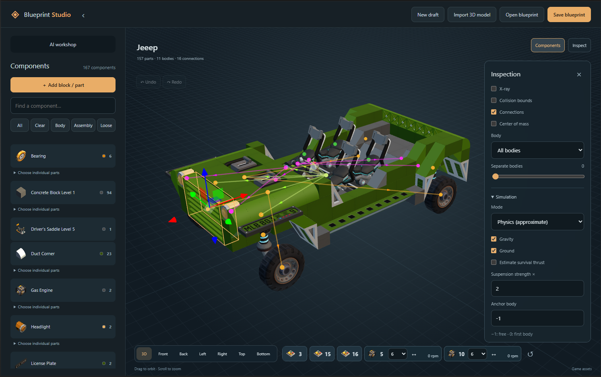

# Scrap Mechanic Blueprint Studio

**Build, edit, inspect and test Scrap Mechanic creations with original game assets and your own AI coding session.**

[Download](https://github.com/21Suspect/Scrap-Mechanic-Blueprint-Studio/releases/latest) · [Installation](docs/INSTALL.md) · [User guide](docs/USER_GUIDE.md) · [AI & development](docs/AI_AND_DEVELOPMENT.md) · [Report a bug](https://github.com/21Suspect/Scrap-Mechanic-Blueprint-Studio/issues)



Made by [21Suspect](https://github.com/21Suspect). A local browser application for Windows. **No paid AI API, API keys or hidden AI fallback.** Manual editing needs no AI account; AI generation runs in your existing Codex session, subject to its plan limits.

## Easy installation

1. Install [Node.js 22 or newer](https://nodejs.org/en/download) and Scrap Mechanic through Steam. Launch the game once to create your profile.
2. Download **BlueprintStudio-v0.1.0.zip** from [Releases](https://github.com/21Suspect/Scrap-Mechanic-Blueprint-Studio/releases/latest).
3. Extract it to a writable folder such as `Documents/BlueprintStudio`. Do not run from inside the ZIP.
4. Double-click **Start-Blueprint-Studio.cmd**. First launch installs npm dependencies, starts the local server and opens your browser.
5. Choose **New draft**, **Open blueprint**, or **Import 3D model**.

Steam libraries and your blueprint profile are detected automatically, including installations on other drives. No administrator access or game-file patching is needed. See [Installation](docs/INSTALL.md) for custom paths, multiple accounts and troubleshooting.

## Features

### View and inspect

- Original installed game meshes, textures, block materials, paint and inventory icons; transparent glass and native resizable wedges.
- Orbit/pan/zoom, seven views, inspection sheets, colored connections, X-ray, collision bounds, body isolation and exploded views.
- Component inventory and searchable part library with UUID, dimensions and available weight/buoyancy metadata.
- Estimated center of mass, validation diagnostics and explicit missing-asset reports.

### Build and edit

- Named drafts, game blueprint/JSON loading, searchable thumbnail tiles and recoverable draft deletion.
- Place native blocks and parts; select individual block cells, multiple parts, bodies or assemblies. Double-click selects matching shapes.
- Centered XYZ gizmo, snapped movement, rotation, mirror, duplicate, delete, paint, replacement, undo/redo and body separation.
- Batch-edit matching interactive parts without duplicating controller IDs or wiring.
- Engine gears, steering bearings, lights, sensors, logic gates, timers, thrusters, pistons and controller sequence settings.
- Save to the game's blueprint folder. Same-name replacement asks for confirmation and keeps a backup. Draft saves and JSON downloads are separate.

### Preview mechanisms and drive

- Switch/button controls beside the view selector, connected lights, six logic gate modes and timer propagation.
- Controller timelines with shared steps, incremental bearing angles, absolute piston lengths, return travel and supported loops.
- Automatic sensors with range, paint filtering, button/switch mode and moving-body detection.
- **Mechanisms** for prescribed motion; **Physics (approximate)** for gravity, ground contact, passive bearing chains, motors, suspension, pistons and thrust.
- **WASD driving** when there is exactly one driver seat or saddle: forward/reverse, steering and connected thrusters. Key release and focus changes release input.
- Thruster flame animation, light activation and supported native on/off poses.
- Automated motion collision sweeps, collision replay and downloadable reports.

### Import 3D models

- Voxelize **GLB/glTF, OBJ/MTL, STL, PLY, FBX, DAE, 3MF and 3DS** into editable native blocks.
- Target size, orientation, material, shell/solid fill and color detail controls. Texture/material/vertex colors become block paint.
- Source/voxel comparison and optional largest-island selection. Add game parts, doors, bearings and wiring afterward.
- No application size caps; large human imports show resource warnings. RAM, browser and game limits still apply.
- Local CLI, HTTP and MCP conversion interfaces for AI workflows.

### AI-assisted creation

- Copy a detailed construction brief into your existing Codex session.
- Generate reproducible JavaScript recipes with `BlueprintBuilder` and the installed catalog.
- Validate rotations, joint anchors, connections, sticky faces, references and wedge limits; capture and inspect all sides.
- Test inputs, mechanisms, collisions and mass through browser APIs, HTTP endpoints or the optional MCP server, then revise.
- Studio makes no AI calls and never uses browser authentication tokens.

## Controls

| Action | Control |
|---|---|
| Orbit / zoom / pan | Drag / scroll / right-drag |
| Select several parts | Shift/Ctrl-click |
| Select all matching parts | Double-click |
| Duplicate / delete | Ctrl+D / Delete |
| Undo / redo | Ctrl+Z / Ctrl+Shift+Z |
| Toggle connections | C |
| Restore editing pose | Escape / Reset |
| Drive / reverse | W / S in Physics mode |
| Steer | A / D in Physics mode |

## What is approximate?

**Studio is not the Scrap Mechanic engine.** It uses Three.js and Rapier with native assets and saved settings where available. Steering torque, suspension calibration, mass, friction and some collision geometry are estimates. Terrain/player sensing, inventories, fuel consumption, crafting, weapons, tire behavior, buoyancy and aerodynamics are not fully simulated. Some scripted/modded parts remain unsupported.

Validation and finite collision sweeps do **not** certify flight, handling, native timing or absence of `Invalid Joint Position`. Spawn and test final creations in the game. Preview poses never overwrite saved creations. Read the [user guide](docs/USER_GUIDE.md) for practical limits.

## Development and contributions

```sh
npm ci
npm test
npm start
```

`npm test` runs portable tests without game assets. Native-asset and personal-reference integration tests are separate. See [AI & development](docs/AI_AND_DEVELOPMENT.md) and [CONTRIBUTING.md](CONTRIBUTING.md).

For bug reports, include the version, affected part/settings, reproduction steps and a small blueprint you have permission to share. Native-game comparison screenshots help with physics issues.

## License and credits

Studio source is [MIT licensed](LICENSE). Dependencies retain their licenses; see [Third-party notices](THIRD_PARTY_NOTICES.md). Scrap Mechanic and its assets belong to Axolot Games and are loaded from each user's installation, **not distributed** in this repository or release. The preview image demonstrates rendering; it does not license the depicted game assets. This is an independent community project, not an official Axolot Games product.
